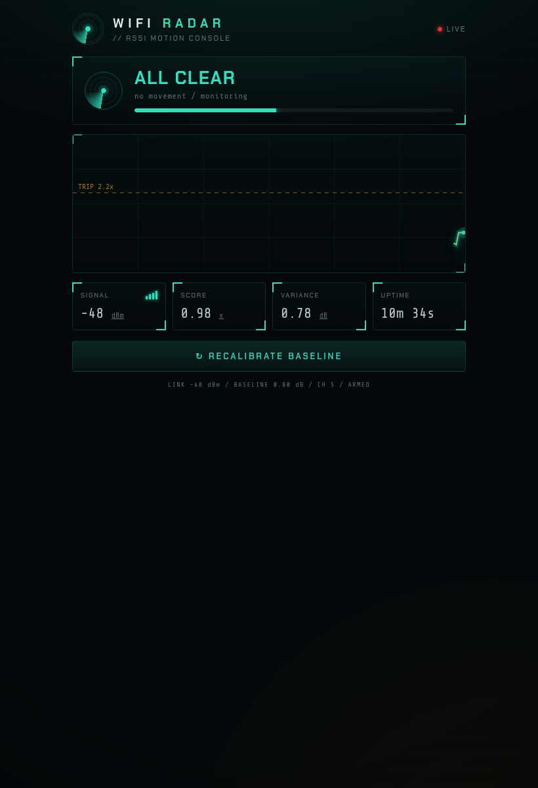

# WiFi Radar — ESP8266 RSSI Motion Radar

[](LICENSE)


Motion and presence detection on a bare **ESP8266** using nothing but the WiFi signal —
no camera, no PIR, no extra sensors. A moving body disturbs the 2.4 GHz multipath in a room,
which makes the received signal strength (RSSI) fluctuate. The firmware learns an empty-room
baseline, reports motion when that fluctuation rises above it, and serves a real-time web
dashboard.



> Live capture from this build: `ALL CLEAR`, link `-48 dBm`, channel 5, armed.
> See [`docs/serial-motion.log`](docs/serial-motion.log) for a real **MOTION** detection.

---

## What was done in this build (session log)

This repo is the fully-built, flashed, and verified result of the following end-to-end session.

| Step | What happened |
|---|---|
| 1. Hardware | Connected an **ESP8266MOD (ESP-12E)** board over a **Silicon Labs CP2102 USB-UART bridge** to an **Arch Linux** host. |
| 2. Toolchain | No toolchain was installed, so PlatformIO Core was installed into an isolated venv (`pip install platformio`). |
| 3. Build | Compiled `espressif8266` / Arduino framework firmware with PlatformIO. |
| 4. WiFi gotcha | Board refused to connect — it is **2.4 GHz only**, and the host was joined to the **5 GHz** SSID. Retargeted to the 2.4 GHz SSID. |
| 5. Flash | Flashed `firmware.bin` (341 KB) via `esptool` at 115200 baud. Chip: `ESP8266EX`, MAC `e8:68:e7:dc:d7:4e`. |
| 6. Verify | Board joined WiFi on channel 5, auto-calibrated, and both serial and the web dashboard reported live data — including a **MOTION** event. |
| 7. Publish | Source, a live dashboard screenshot, and a serial motion log committed to this private repo. |

### Board used

| Item | Detail |
|---|---|
| MCU board | **ESP8266MOD "ESP-12E"** style module |
| WiFi | 2.4 GHz 802.11 b/g/n (only — no 5 GHz) |
| USB-UART | **Silicon Labs CP2102** (`idVendor 10c4`, `idProduct ea60`) → `/dev/ttyUSB0` |
| Flash | 4 MB |
| Toolchain | PlatformIO `platform = espressif8266`, `board = esp12e`, `framework = arduino` |
| Host OS | Arch Linux (kernel 7.x) |

### Notes from the build

- **Network throttling workaround:** the package registry CDN was throttled to ~15 KB/s on this
  network, which made the ~74 MB Xtensa toolchain take hours. The needed packages were fetched
  with **parallel ranged HTTPS requests** (≈16× throughput) and pre-seeded into PlatformIO's
  download cache so the normal `pio` flow used them. See the "Offline / slow-network install"
  section below.
- **Serial permissions:** `/dev/ttyUSB0` is `root:uucp`; a persistent udev rule was added so the
  board can be re-flashed and read without `sudo`.
- **WiFi credentials** live in `src/secrets.h`, which is git-ignored and never committed.

---

## Features

- Runs on any ESP8266 with no additional hardware.
- Detects motion from RSSI variance against an auto-calibrated baseline.
- Real-time web dashboard with a live signal scope and motion state.
- Low resource use: about 36 % RAM and a ~137-byte telemetry payload per poll.
- Onboard LED and serial output for status without a browser.
- mDNS hostname (`wifiradar.local`).
- Sensitivity and timing exposed as configurable constants.

## How it works

WiFi from the router reaches the ESP8266 over many reflected paths that combine into a single
RSSI value — a fingerprint of the room. A moving person changes those paths, so RSSI fluctuates.
The firmware samples RSSI at 20 Hz, computes the standard deviation over a ~3-second window,
divides it by a calibrated empty-room baseline to produce a *score*, and reports motion when the
score crosses a threshold (with hysteresis to prevent flicker).

See [`docs/how-it-works.md`](docs/how-it-works.md) for the full explanation.

## Hardware

| Component | Requirement |
|---|---|
| Board | Any ESP8266 (ESP-12E/F, NodeMCU, Wemos D1 mini, ESP-07) |
| Flash | 1 MB minimum, 4 MB recommended |
| Programmer | Onboard USB, or a USB-serial adapter (FTDI, **CP2102**, CH340) |
| Additional parts | None |

## Quick start

### PlatformIO

```bash
git clone https://github.com/RayanErfan/esp8266-wifi-radar.git
cd esp8266-wifi-radar
cp src/secrets.example.h src/secrets.h    # add your 2.4 GHz WiFi SSID/password
pio run -t upload
pio device monitor
```

### Arduino IDE

1. Install the ESP8266 board package (Boards Manager, search "esp8266").
2. Copy `src/secrets.example.h` to `src/secrets.h` and set your **2.4 GHz** WiFi credentials.
3. Open `src/main.cpp`, select your board, and upload.

On boot the board connects to WiFi, prints its IP over serial, runs a 10-second baseline
calibration (stay still or leave the room), then begins sensing.

> **Important:** the ESP8266 only supports **2.4 GHz**. If your router uses the same name for both
> bands but puts 5 GHz-only on one of them, connect the board to the **2.4 GHz** SSID.

WiFi credentials are stored in `src/secrets.h`, which is git-ignored and never committed.

## Offline / slow-network install

If the toolchain download is throttled, pre-fetch the four packages and drop them into the
PlatformIO cache. Cache filename = `sha1(<redirect-location> + <sha256>)`; fetch the redirect
location and `x-pio-content-sha256` header with a `HEAD` request to the registry URL, then copy the
verified file to `~/.platformio/.cache/downloads/<sha1>`. Packages for `esp12e`/arduino:

| Package | Version | Size |
|---|---|---|
| `toolchain-xtensa` (linux_x86_64) | 2.100300.220621 | ~74 MB |
| `framework-arduinoespressif8266` | 3.30102.0 | ~36 MB |
| `tool-esptoolpy` | 1.30000.201119 | ~6.6 MB |
| `tool-esptool` (linux_x86_64) | 1.413.0 | ~16 KB |

## Configuration

Constants at the top of [`src/main.cpp`](src/main.cpp):

| Constant | Default | Description |
|---|---|---|
| `TRIP_FACTOR` | 2.2 | Score (multiple of baseline) required to enter the motion state |
| `CLEAR_FACTOR` | 1.5 | Score below which the motion state clears |
| `WINDOW` | 64 | Live averaging window in samples (about 3.2 s) |
| `CAL_SAMPLES` | 200 | Calibration length in samples (about 10 s) |
| `MOTION_HOLD_MS` | 2000 | Minimum time held in the motion state |
| `SAMPLE_INTERVAL_MS` | 50 | RSSI sample period (20 Hz) |

Raise `TRIP_FACTOR` to reduce sensitivity, lower it to increase sensitivity. Recalibrate after
moving the board.

## Dashboard and HTTP API

Open `http://wifiradar.local`, or the IP shown on serial (this build: `http://192.168.1.58/`).

| Endpoint | Method | Response |
|---|---|---|
| `/` | GET | Dashboard page |
| `/data` | GET | Telemetry JSON (about 137 bytes) |
| `/recal` | GET | Re-runs baseline calibration |

Example `/data` response from this build:

```json
{"rssi":-42,"std":0.50,"score":0.57,"motion":false,"calibrated":true,"cal":200,"calTotal":200,"baseline":0.87,"trip":2.20,"up":213,"ch":5}
```

## Serial output

Real capture from this build (full log: [`docs/serial-motion.log`](docs/serial-motion.log)):

```text
RSSI  -42 dBm | std  0.50 | x 0.62 [#####-------------------------] idle
RSSI  -47 dBm | std  0.80 | x 1.00 [#########---------------------] idle
RSSI  -48 dBm | std  1.65 | x 2.06 [##################------------] idle
RSSI  -46 dBm | std  1.76 | x 2.21 [####################----------] ** MOTION **
RSSI  -44 dBm | std  1.75 | x 2.19 [###################-----------] ** MOTION **
RSSI  -53 dBm | std  2.00 | x 2.50 [######################--------] ** MOTION **
```

## Limitations

- Detects motion and presence only — not identity, count, position, or pose, and not an image.
- Effective range is roughly one room and depends heavily on the environment.
- Requires a brief still calibration; recalibrate after moving the board or rearranging the room.
- More ambient WiFi traffic improves sampling. The firmware sends small UDP packets to the router
  to keep readings fresh.
- Uses RSSI, which is coarser than CSI-based WiFi sensing (full CSI needs an ESP32 or specialized
  network cards).

## Ethics

This is a research/education project for **your own space**. WiFi sensing is non-line-of-sight and
works without the occupant's knowledge, so only deploy it where you have consent and it is legal.

## Contributing

See [CONTRIBUTING.md](CONTRIBUTING.md) and the [Code of Conduct](CODE_OF_CONDUCT.md).

## License

Released under the [MIT License](LICENSE). Based on
[mandarwagh9/esp8266-wifi-radar](https://github.com/mandarwagh9/esp8266-wifi-radar).

## Acknowledgements

Built with the [ESP8266 Arduino core](https://github.com/esp8266/Arduino) and
[PlatformIO](https://platformio.org/).
